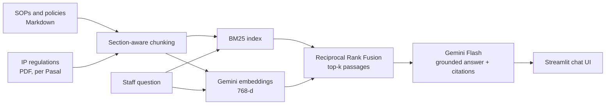

# ⚖️ Pasalytics: IP Firm Knowledge Assistant (RAG over SOPs and Indonesian IP Regulations)

**Pasalytics** (*Pasal* + *analytics*) is a retrieval-augmented generation (RAG) assistant that answers staff questions about filing procedures, deadlines, fees and internal policies of an intellectual property (IP) firm, **citing the exact passage behind every answer** and refusing to guess when the answer is not in the knowledge base.

**Stack:** Python · Google Gemini (`gemini-embedding-001` + Gemini Flash) · BM25 · Hybrid search (Reciprocal Rank Fusion) · Streamlit · LLM-as-judge evaluation

---

## 1. Business Problem

In an IP firm, a wrong deadline or a wrong fee quoted to a client is costly. Yet the answers live in dozens of SOPs, policies and regulations, so staff:

- spend minutes per question searching folders and PDFs,
- interrupt senior colleagues with the same routine questions,
- take weeks to onboard, because procedures are learned by asking around.

A general chatbot does not help: it does not know the firm's procedures and may invent numbers.

## 2. Solution

A knowledge assistant that:

1. **Retrieves** the most relevant passages with hybrid search (BM25 for exact codes and numbers + Gemini embeddings for paraphrases and English↔Indonesian matching).
2. **Answers only from those passages**, citing them as `[1]`, `[2]`, and quoting numbers exactly.
3. **Says "I could not find this in the knowledge base"** when the documents do not cover the question.
4. Is **measured**: retrieval Hit@k / MRR and answer correctness, faithfulness and refusal accuracy on a 66-question evaluation set.



## 3. Data

| Source | Content | Notes |
|---|---|---|
| `data/raw/internal_docs/` | 20 SOPs and policies (trademark, patent, design, copyright, billing, confidentiality, HR, disputes) | **Synthetic.** Written for this project for a fictional firm, *Lumina IP Partners*. All names, fees and internal rules are invented. |
| `data/raw/regulations/` | Indonesian IP laws (PDF) | **Public.** Downloaded from official government sources. See the folder's README. |
| `data/eval/eval_questions.csv` | 66 questions with expected source document and reference answer | 42 factual, 19 paraphrased, 5 unanswerable |

No real client or firm data is used.

## 4. Results

### Retrieval (61 answerable questions)

| Retriever | Hit@1 | Hit@3 | Hit@5 | MRR |
|---|---|---|---|---|
| BM25 (lexical baseline) | 0.852 | 0.967 | 0.984 | 0.903 |
| Dense (Gemini embeddings) | *run notebook 03* | | | |
| **Hybrid (RRF)** | *run notebook 03* | | | |

**Key finding:** BM25 reaches Hit@1 = 0.95 on factual questions but only **0.63 on paraphrased questions** (e.g. *"a client forgot to renew"* vs the document's *"grace period"*). Closing that gap is the reason for adding semantic embeddings and hybrid fusion.

### Answer quality (LLM-as-judge, notebook 04)

| Metric | Result |
|---|---|
| Correctness (1–5) | *run notebook 04* |
| Faithfulness (1–5) | |
| Answers with citation | |
| Correct refusals on unanswerable questions | |


## 5. Project Structure

```
pasalytics/
├── app.py                         # Streamlit chat app
├── data/
│   ├── raw/internal_docs/         # 20 synthetic SOPs and policies (Markdown)
│   ├── raw/regulations/           # public IP regulation PDFs (download, see README)
│   ├── processed/                 # chunks.jsonl, embeddings.npy, index_meta.json
│   └── eval/eval_questions.csv    # evaluation set
├── notebooks/
│   ├── 01_corpus_exploration.ipynb
│   ├── 02_chunking_and_indexing.ipynb
│   ├── 03_retrieval_evaluation.ipynb
│   └── 04_rag_answer_evaluation.ipynb
├── reports/figures/
├── src/
│   ├── config.py                  # paths, model names, parameters
│   ├── ingest.py                  # load Markdown and PDF documents
│   ├── chunking.py                # section-aware and article-aware chunking
│   ├── embeddings.py              # Gemini embeddings (batched, retried, normalised)
│   ├── retriever.py               # BM25, dense and hybrid (RRF) retrievers
│   ├── generator.py               # grounded prompt, citations, refusal
│   ├── evaluation.py              # Hit@k, MRR, LLM-as-judge
│   └── build_index.py             # CLI to rebuild the index
├── requirements.txt
└── .env.example
```

## 6. How to Run

```bash
git clone https://github.com/<your-username>/pasalytics.git
cd pasalytics
pip install -r requirements.txt

cp .env.example .env              # then paste your key from https://aistudio.google.com/apikey
python -m src.build_index         # chunks + embeddings (free tier is enough)
streamlit run app.py
```

Without an API key, `python -m src.build_index --no-embed` builds a BM25-only index, and the app shows the retrieved passages instead of a generated answer.

**Deploy on Streamlit Cloud:** commit `data/processed/` (built locally), create the app from the repo, and add `GEMINI_API_KEY` under *Settings → Secrets*.

## 7. Design Decisions

- **Section-aware chunking** instead of fixed-size windows: a chunk never mixes two procedures, and each one carries a breadcrumb (`SOP-TM-05 Trademark Renewal > 4. Fees`) so short sections stay retrievable.
- **Hybrid retrieval**: legal and procedural text is full of codes and numbers that lexical search matches perfectly, while staff questions are paraphrased; RRF combines both without tuning score scales.
- **NumPy vector store**: about 100 to a few thousand chunks fit in memory; a vector database would add deployment complexity without benefit at this scale.
- **Explicit refusal string** so "I don't know" behaviour can be measured, not just hoped for.

## 8. Limitations and Next Steps

- Add a cross-encoder or Gemini-based **reranker** on the top-20 candidates.
- **Query rewriting** for very short or ambiguous questions.
- Access control per document (e.g. HR policies visible only to HR).
- Scanned regulation PDFs need OCR before indexing.
- Track cost and latency per query (LLMOps).

---
*Disclaimer: answers describe firm procedures in a synthetic knowledge base and are not legal advice.*
