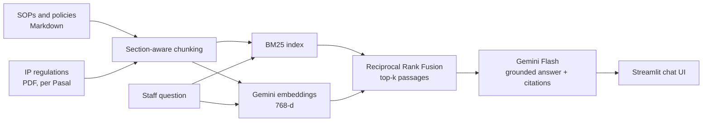
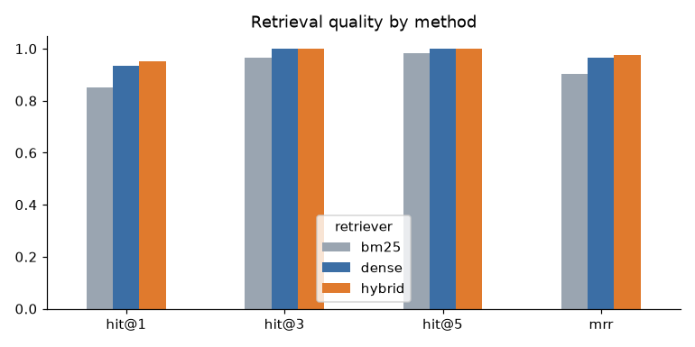

# ⚖️ Pasalytics: IP Firm Knowledge Assistant (RAG over SOPs and Indonesian IP Regulations)

**Pasalytics** (*Pasal* + *analytics*) is a retrieval-augmented generation (RAG) assistant that answers staff questions about filing procedures, deadlines, fees and internal policies of an intellectual property (IP) firm, **citing the exact passage behind every answer** and refusing to guess when the answer is not in the knowledge base.

**Stack:** Python · Google Gemini (`gemini-embedding-001` + Gemini Flash) · BM25 · Hybrid search (Reciprocal Rank Fusion) · Streamlit · LLM-as-judge evaluation

---

## 1. Business Problem

In an IP firm, a wrong deadline or a wrong fee quoted to a client is costly. Yet the answers live in dozens of SOPs, policies and regulations, so staff:

- spend minutes per question searching folders and PDFs,
- interrupt senior colleagues with the same routine questions,
- take weeks to onboard, because procedures are learned by asking around.

A general chatbot does not help: it does not know the firm's procedures and may invent numbers.

## 2. Solution

A knowledge assistant that:

1. **Retrieves** the most relevant passages with hybrid search (BM25 for exact codes and numbers + Gemini embeddings for paraphrases and English↔Indonesian matching).
2. **Answers only from those passages**, citing them as `[1]`, `[2]`, and quoting numbers exactly.
3. **Says "I could not find this in the knowledge base"** when the documents do not cover the question.
4. Is **measured**: retrieval Hit@k / MRR and answer correctness, faithfulness and refusal accuracy on a 66-question evaluation set.



## 3. Data

| Source | Content | Notes |
|---|---|---|
| `data/raw/internal_docs/` | 20 SOPs and policies (trademark, patent, design, copyright, billing, confidentiality, HR, disputes) | **Synthetic.** Written for this project for a fictional firm, *Lumina IP Partners*. All names, fees and internal rules are invented. |
| `data/raw/regulations/` | Indonesian IP laws (PDF) | **Public.** Downloaded from official government sources. See the folder's README. |
| `data/eval/eval_questions.csv` | 66 questions with expected source document and reference answer | 42 factual, 19 paraphrased, 5 unanswerable |

No real client or firm data is used.

## 4. Results

### Retrieval (61 answerable questions)

| Retriever | Hit@1 | Hit@3 | Hit@5 | MRR |
|---|---|---|---|---|
| BM25 (lexical baseline) | 0.852 | 0.967 | 0.984 | 0.903 |
| Dense (Gemini embeddings) | 0.934 | 1.000 | 1.000 | 0.964 |
| **Hybrid (RRF, used in the app)** | **0.951** | **1.000** | **1.000** | **0.975** |

Hit@1 by question type:

| Retriever | Factual (42) | Paraphrased (19) |
|---|---|---|
| BM25 | 0.952 | 0.632 |
| Dense | 0.905 | **1.000** |
| Hybrid | **0.976** | 0.895 |

**Key findings**
- **Keyword search breaks on real staff phrasing.** BM25 finds the right document first for 95% of factual questions but only **63% of paraphrased ones** (*"a client forgot to renew"* vs the document's *"grace period"*).
- **Embeddings fix paraphrases but lose some precision.** Dense retrieval ranks the right document first for every paraphrased question, yet drops to 0.905 on factual questions, where exact terms such as fee names and SOP codes matter.
- **Hybrid gives the best overall result.** Fusing both lifts Hit@1 from 0.852 to **0.951** (+10 points) and MRR to **0.975**, and the correct source is in the top 3 for **100%** of questions, so the answer model always receives the passage it needs.

**Error analysis.** Hybrid misses rank 1 on only 3 of 61 questions, and in all three the correct document is ranked **2nd**, so it still reaches the answer model:

| Question | Expected | Ranked 1st | Why |
|---|---|---|---|
| When are docketing reminders sent for an office action deadline? | SOP-TM-03 | SOP-TM-05 | Both SOPs describe reminder schedules; "docketing" appears in the title of SOP-TM-05 |
| A client forgot to renew and the mark expired two months ago… | SOP-TM-05 | SOP-TM-01 | Casual wording and "mark" pull towards the trademark search SOP |
| How should I name a draft response file? | POL-DOC-01 | SOP-TM-03 | "Draft response" also describes the office-action SOP |

These overlaps between similar procedures are the target of the next improvement: a reranker on the top candidates.

### Answer quality (LLM-as-judge, notebook 04)

All 66 questions, answer and judge model `gemini-3.5-flash-lite`, hybrid retrieval, top-5 passages.

| Metric | Result |
|---|---|
| Faithfulness (1–5, no hallucination) | **5.00** (every answer fully supported by its sources) |
| Correctness (1–5) | **4.84** |
| Fully correct answers (score 5) | **88.5%** (54 of 61) |
| Answers with a source citation | **91.8%** |
| Correct refusals on unanswerable questions | **100%** (5 of 5) |
| False refusals on answerable questions | **1.6%** (1 of 61) |

| Question type | Correctness | Fully correct |
|---|---|---|
| Factual (42) | 4.86 | 85.7% |
| Paraphrased (19) | 4.79 | 94.7% |

**What the numbers mean**
- **Zero hallucinations.** Faithfulness is 5/5 on every answer, and all 5 questions outside the knowledge base (intern policy, firm revenue, official 2026 DJKI fees…) were answered with *"I could not find this"* instead of an invented figure. For a firm quoting deadlines and fees to clients, this is the most important result.
- **The 6 answers scored 4 are correct but incomplete**, not wrong: the main fact (fee, deadline, currency) is right, while a secondary detail from the reference is left out, e.g. the 14-day response period after a cease-and-desist letter. This comes from the "be concise" instruction and can be tuned in the prompt.
- **One false refusal (Q015).** *"A competitor's similar mark was just published. By when do we need the client's go-ahead to object?"* The relevant SOP was retrieved, but the model did not connect *"go-ahead to object"* with *"instructions for an opposition"* and, following the strict grounding rule, declined rather than infer. A query-rewriting step that maps staff wording to SOP terms is the planned fix.
- **5 answers lacked a bracketed citation** although they were correct; a stricter output format (or a post-check that adds the source) closes this gap.



## 5. Project Structure

```
pasalytics/
├── app.py                         # Streamlit chat app
├── data/
│   ├── raw/internal_docs/         # 20 synthetic SOPs and policies (Markdown)
│   ├── raw/regulations/           # public IP regulation PDFs (download, see README)
│   ├── processed/                 # chunks.jsonl, embeddings.npy, index_meta.json
│   └── eval/eval_questions.csv    # evaluation set
├── notebooks/
│   ├── 01_corpus_exploration.ipynb
│   ├── 02_chunking_and_indexing.ipynb
│   ├── 03_retrieval_evaluation.ipynb
│   └── 04_rag_answer_evaluation.ipynb
├── reports/figures/
├── src/
│   ├── config.py                  # paths, model names, parameters
│   ├── ingest.py                  # load Markdown and PDF documents
│   ├── chunking.py                # section-aware and article-aware chunking
│   ├── embeddings.py              # Gemini embeddings (batched, retried, normalised)
│   ├── retriever.py               # BM25, dense and hybrid (RRF) retrievers
│   ├── generator.py               # grounded prompt, citations, refusal
│   ├── evaluation.py              # Hit@k, MRR, LLM-as-judge
│   └── build_index.py             # CLI to rebuild the index
├── requirements.txt
└── .env.example
```

## 6. How to Run

```bash
git clone https://github.com/<your-username>/pasalytics.git
cd pasalytics
pip install -r requirements.txt

cp .env.example .env              # then paste your key from https://aistudio.google.com/apikey
python -m src.build_index         # chunks + embeddings (free tier is enough)
streamlit run app.py
```

Without an API key, `python -m src.build_index --no-embed` builds a BM25-only index, and the app shows the retrieved passages instead of a generated answer.

**Deploy on Streamlit Cloud:** commit `data/processed/` (built locally), create the app from the repo, and add `GEMINI_API_KEY` under *Settings → Secrets*.

## 7. Design Decisions

- **Section-aware chunking** instead of fixed-size windows: a chunk never mixes two procedures, and each one carries a breadcrumb (`SOP-TM-05 Trademark Renewal > 4. Fees`) so short sections stay retrievable.
- **Hybrid retrieval**: legal and procedural text is full of codes and numbers that lexical search matches perfectly, while staff questions are paraphrased; RRF combines both without tuning score scales.
- **NumPy vector store**: about 100 to a few thousand chunks fit in memory; a vector database would add deployment complexity without benefit at this scale.
- **Explicit refusal string** so "I don't know" behaviour can be measured, not just hoped for.

## 8. Limitations and Next Steps

- Add a cross-encoder or Gemini-based **reranker** on the top-20 candidates.
- **Query rewriting** that maps staff wording to SOP terminology (would fix the one false refusal).
- Enforce citations on every answer with a post-generation check.
- Access control per document (e.g. HR policies visible only to HR).
- Scanned regulation PDFs need OCR before indexing.
- Track cost and latency per query (LLMOps).

---
*Disclaimer: answers describe firm procedures in a synthetic knowledge base and are not legal advice.*
